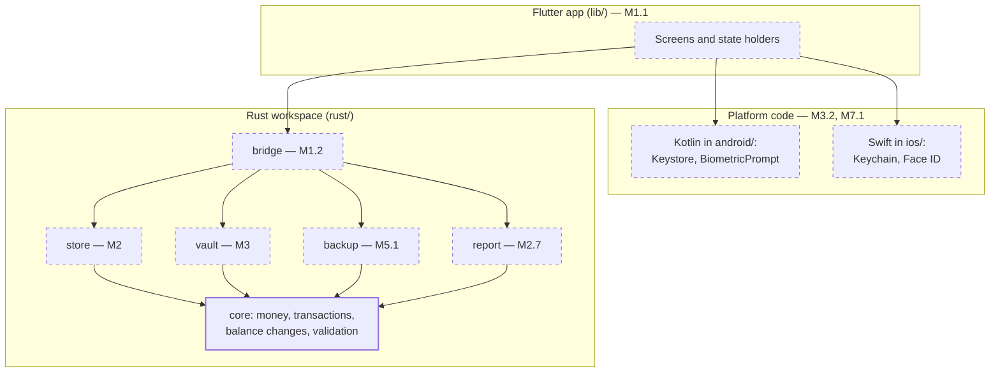

# 01 — Architecture

Denarii Dolor's rewrite is a Flutter app (the screens, in Dart) over a Rust core (the rules and the
data), with a thin layer of Kotlin and, later, Swift for what only the operating system can do:
hardware-backed keys and the biometric prompt. This document says which layer owns what, which
layer may call which, and where each part lives. What is built today is listed in the "Status"
section of `CLAUDE.md` and ticked in `docs/roadmap.md`; this document describes the design and
names the task that builds each planned part.

## Principles

1. **The data on users' phones comes first.** The new app reads the database, the vault profile,
   the Keystore keys, and the backup files that v1 wrote, exactly as
   `docs/specs/android-v1-formats.md` describes them (ADR-0002, existing installs upgrade in
   place). A design that can't do that is wrong, however clean it is.
2. **Each rule exists once.** Money parsing, balance changes, validation, storage, and backups are
   written in Rust and tested on the host, so Android and iOS can't disagree (ADR-0004, Proposed:
   Rust owns the rules and the data).
3. **Screens hold no business rules.** Dart shows state, collects input, and calls the core. It
   formats money and dates for the user's locale, because that is presentation.
4. **Secrets stay out of Dart.** A PIN leaves Dart once, on its way to the vault. Keys never enter
   Dart, because the Dart runtime can't wipe memory it has freed (ADR-0007, Proposed: hardware-key
   operations stay in platform code).
5. **The app is offline.** No layer opens a network connection (ADR-0008, the app stays offline).
6. **Money is a whole number of cents** (`i64` in Rust, `int` in Dart) from input to storage.
   Floating point is used only to draw charts.

## Layers

Solid boxes are built; dashed boxes are planned, labeled with the task that builds them.

| Layer | Lives in | Owns | May call |
| :- | :- | :- | :- |
| Screens and state holders | `lib/` | Layout, navigation, input, locale formatting, one write at a time | `bridge`, the platform channels |
| Platform code | `android/`, `ios/` | Hardware-backed keys, the biometric prompt, file pickers, the share sheet | The operating system only |
| `bridge` | `rust/crates/bridge` | The API Dart calls; turning errors into stable codes | `store`, `vault`, `backup`, `report`, `core` |
| `store` | `rust/crates/store` | The SQLCipher database, schema and migrations, queries, and the transaction, category, account, and budget use cases | `core`, approved crates |
| `vault` | `rust/crates/vault` | The profile, key wrapping, PIN and answer rules, the lockout, and the session | `core`, approved crates |
| `backup` | `rust/crates/backup` | Writing and reading backup files of every format version | `core`, approved crates |
| `report` | `rust/crates/report` | Monthly totals, search, and CSV text | `core` |
| `core` | `rust/crates/core` | Money, transactions, balance changes, validation, the seeded defaults | `std` only |

Dependency rules, each carried over from v1's `CLAUDE.md` in the new terms:

1. `core` depends on nothing but `std`. No crate depends on `bridge`.
2. Dart never sees a database row or a key. The bridge gives it plain records and error codes.
3. Every transaction write goes through a `store` use case, which validates it with
   `core::validate_transaction` and applies `core::balance_deltas` in the same database transaction
   as the row.
4. The database exists only after sign-in. The bridge offers no storage call until the vault has
   unlocked the database key, and locking closes the database and wipes the key.
5. Anything that depends on "now" takes the time from its caller. Rust reads no clock: Dart passes
   the time, and the time zone's month boundaries, in each call that needs them (decided in M2.4).
6. Text shown to users comes from the ARB files in `lib/l10n/`. Rust returns a `DomainError` code
   such as `BUDGET_EXCEEDED`, never a sentence for users.

## Source layout

| Path | Contents | Built by |
| :- | :- | :- |
| `rust/Cargo.toml` | The workspace, shared package fields, and lints | M0.4 |
| `rust/crates/core` | `denarii-core`; its design is in `docs/specs/core.md` | M0.4–M0.7 |
| `rust/crates/{store,vault,backup,report,bridge}` | The planned crates in the table above | M1.2–M5.1 |
| `pubspec.yaml`, `lib/`, `test/`, `integration_test/` | The Flutter app and its tests | M1.1 |
| `android/` | Flutter's Android host app and the Kotlin platform code | M1.1, M3.2 |
| `ios/` | Flutter's iOS host app and the Swift platform code | M7.1 |
| `docs/` | These documents, the decision log, the roadmap, and the specs | M0.3 |

v1's Kotlin source left the working tree under ADR-0003 (replace the Kotlin app now). Read any of
it with `git show 6d57526:<path>`. Where v1's code now goes:

| v1 code at `6d57526` | New home | Task |
| :- | :- | :- |
| `shared/.../domain/model`, `util/Money.kt`, `util/Validators.kt`, `ValidateTransactionUseCase.kt` (field rules) | `core` | M0.5–M0.7 |
| `app/.../data/local/db`, `data/repository`, `domain/usecase` | `store` | M2.2–M2.6 |
| `app/.../data/local/vault`, `data/local/preferences/SecurityProfileService.kt` | `vault`, plus Kotlin for the Keystore | M3.2–M3.4 |
| `app/.../data/backup`, `shared/.../data/backup` | `backup` | M5.1 |
| `shared/.../domain/report`, `GenerateReportUseCase.kt`, `SearchTransactionUseCase.kt` | `report` | M2.7 |
| `app/.../presentation/ui/**` | `lib/features/**` | M3.5–M4.7 |
| `app/src/main/res/values*/strings.xml` | `lib/l10n/*.arb` | M1.4 |
| `util/PlatformFormat.kt` (money and month text) | Dart, with `package:intl` | M1.6 |

## Main control flow

1. **Start.** The app opens on the sign-in screen. Nothing reads the database yet.
2. **Sign in.** The screen sends the PIN to the vault. With ADR-0007's proposed split, Rust
   stretches the PIN with PBKDF2, the Kotlin code mixes the result with the Keystore device key,
   and Rust unwraps the database key. The biometric path unwraps it in Kotlin through a
   `CryptoObject` instead.
3. **Open.** `store` opens the SQLCipher database with that key and checks its `user_version`,
   migrating forward if needed. The session timer starts.
4. **Use.** Each screen calls the bridge. A write runs validation, then one database transaction
   that writes the row and the balance changes together.
5. **Lock.** Sign-out, the 5-minute timeout (CS-01), or wipe closes the database and wipes the
   key from memory.

## Threading

`core` and the other crates expose synchronous functions and start no threads. The database is one
connection that one caller uses at a time. The bridge runs each call off Flutter's UI thread, so a
slow call (PBKDF2 takes hundreds of milliseconds) never freezes the screen; how it does that is
decided with ADR-0005 in M1.2.

## Configuration

There is no runtime configuration besides the user's settings (currency, theme, and the tour and
rating state), which v1 keeps in the `ui_prefs` file that `docs/specs/android-v1-formats.md`
describes. Build-time settings are the application ID, the SDK levels, and the signing setup,
listed in the project details of `.claude/rules/flutter.md`.
